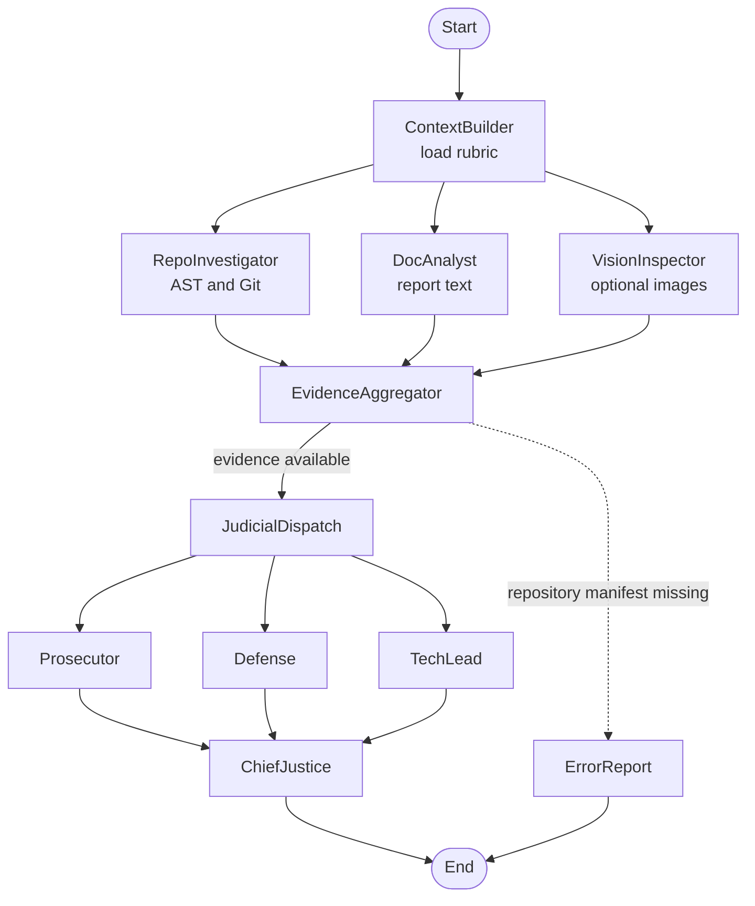

# Automaton Auditor

An architecture field guide to an evidence-grounded, human-reviewed audit system.

<!-- pagebreak -->

# 01 | Executive briefing

## Executive briefing

The Automaton Auditor reviews a software repository and its accompanying report against a machine-readable rubric. It gathers repository, document, and optional diagram evidence in parallel; asks three independent, schema-constrained judges to assess each criterion; then applies explicit Python rules to resolve their opinions and write an actionable Markdown audit.

The design is intentionally two-part: models interpret evidence, while code controls how evidence is merged, which opinions count, how disagreements are resolved, and when a criterion must remain unscored. This makes the workflow inspectable without pretending that model judgment is infallible.

**At a glance**

- **Input:** a Git repository URL, a rubric, and a PDF, Markdown, or text report.
- **Output:** an evidence-based Markdown audit with criterion scores, dissent, and remediation.
- **Core:** LangGraph orchestration, typed shared state, Pydantic validation, and deterministic score resolution.
- **Human boundary:** the auditor can evaluate itself; a person decides what to change and whether to run it again.

This guide describes the implementation in this project as of 12 November 2026. It is an architecture description, not a claim that the system learns or changes its own source code.

<!-- pagebreak -->

# 02 | The system at a glance



### Reading the map

Solid arrows show graph flow; the dashed route to `ErrorReport` handles a missing repository manifest. This map reflects `src/graph.py`, not a source-only drawing.

<!-- pagebreak -->

# 03 | A run, four movements

### Prepare and investigate

**Prepare.** `ContextBuilder` loads and validates the rubric. It defines what evidence the audit should seek and how final opinions are synthesized.

**Investigate in parallel.** `RepoInvestigator` inspects repository structure, source, and available Git history. `DocAnalyst` reads the supplied report, checks substantive concept coverage, and extracts claimed file paths. `VisionInspector` checks extracted report images when a compatible vision model is configured.

### Reconcile before judgment

`EvidenceAggregator` waits for the investigators, verifies report paths against the repository manifest, and compares available diagram findings with graph evidence. If no repository manifest is available, a conditional route produces an error report instead of starting normal adjudication.

### Judge, then synthesize

`JudicialDispatch` starts Prosecutor, Defense, and TechLead in parallel. Their opinions converge at `ChiefJustice`, which applies evidence and scoring rules before writing the Markdown audit.

Code map: `src/graph.py`; `src/nodes/detectives.py`; `src/nodes/judges.py`; `src/nodes/justice.py`.

<!-- pagebreak -->

# 04 | Parallel work, shared memory

### Fan-In / Fan-Out

Fan-Out is explicit in `src/graph.py`: `ContextBuilder` starts three independent investigator branches, while `JudicialDispatch` starts three judge branches. The graph does not make one investigator wait for another to finish work that can be done independently.

Fan-In is the synchronization boundary. Repository, document, and vision results meet at `EvidenceAggregator` before adjudication; the three judge opinions meet at `ChiefJustice` before a score is resolved. Aggregation is more than a meeting point: it cross-checks report-claimed paths against the repository manifest and compares diagram facts with code-derived graph facts when both are available.

The graph also makes the failure route visible. If the repository manifest is missing, `route_after_aggregation` sends the run to `ErrorReport`; it does not disguise missing repository evidence as a normal audit.

### State Synchronization

`AgentState` in `src/state.py` is a typed shared state with explicit reducers. Reducers define how concurrent node updates combine:

- `operator.add` appends list contributions such as repository paths, claimed paths, errors, and judicial opinions.
- `operator.ior` merges evidence dictionaries keyed by producer, so one investigator's update does not replace another's.

This is the practical meaning of State Synchronization here: branches contribute partial results, reducers preserve those contributions, and downstream nodes run at graph fan-in after the required upstream work has completed. It is a defined merge contract, not an assumption that shared state will sort itself out.

**Why a CTO should care:** the parallelism is useful only if results remain attributable and complete. Typed evidence, explicit reducers, and visible barriers make that property easier to reason about and test.

Code map: `src/graph.py`; `src/state.py` (`AgentState`); `src/nodes/detectives.py` (`evidence_aggregator_node`, `route_after_aggregation`).

<!-- pagebreak -->

# 05 | Three perspectives, one evidence record

### Dialectical Synthesis

Dialectical Synthesis begins when `make_judge_node` gives the same criterion-specific evidence to three separately prompted personas. **Prosecutor** looks for unsupported claims and failures. **Defense** looks for demonstrated intent and fair credit. **TechLead** focuses on operational fitness and pragmatic repair. The disagreement is intentional: the judges pressure-test the same record from different angles rather than pretending there is only one useful lens.

Each judge response is validated against a structured opinion schema. A `JudicialOpinion` has a bounded score, a named judge and criterion, an argument, evidence citations, and a round. The application supplies the judge identity and criterion ID; malformed output is retried, and exhausted retries do not fabricate an opinion.

### Evidence is the constraint

An articulate argument is not enough. `ChiefJustice` checks whether an opinion cites available evidence. Ungrounded opinions are discarded. When no supporting artifact was found for a criterion, a Defense opinion cannot override that absence. This fact-supremacy rule is a guardrail against persuasive prose outranking the audit record.

The metaphor has a precise limit: the judges are model-generated perspectives, not independent human experts. Their opinions can be wrong or inconsistent. The surrounding validation and deterministic resolution constrain their influence; they do not prove every interpretation is correct.

**What is deliberately separated:** models interpret the evidence and propose scores; Python validates the response shape, binds it to the correct judge and criterion, checks citations, and controls how it may affect the outcome.

Code map: `src/nodes/judges.py` (`PROMPTS`, `make_judge_node`); `src/state.py` (`JudicialOpinion`); `src/nodes/justice.py` (`_grounded`, `resolve`).

<!-- pagebreak -->

# 06 | The ruling: deterministic synthesis

### A rule-governed decision

`ChiefJustice` does not simply average every response. It selects the latest opinion round for each judge, removes opinions without usable evidence citations, and calculates a score from the remaining opinions using criterion-specific weights. TechLead carries the highest weight for graph orchestration.

When the score spread is greater than two points, the resolver records dissent and applies its variance rule: a grounded TechLead opinion is used as the tie-breaker when available. Named statutory checks can cap scores for specific implementation failures, including missing parallel graph wiring or unsafe repository-tool behavior. The final report records rule notes so a reader can see why a score changed.

### Unverified is not zero

Some criteria require an artifact the auditor could not inspect. Those criteria are marked **unverified**, left without a numeric score, and excluded from the overall score. This avoids turning unavailable evidence into a false failure or silently rewarding an assumption.

Diagram review illustrates the distinction. A configured vision model may inspect images extracted from the submitted PDF. Without vision, Mermaid source in the repository can provide supplemental topology evidence, but it cannot prove that the submitted PDF contains a correct or readable diagram. In that case the PDF-image criterion remains unverified.

### Confidence without overclaiming

Python makes the resolution process repeatable; it does not make the judges' underlying interpretations deterministic or guarantee that a score is objectively correct. The audit remains evidence-based and reviewable, not an oracle.

Code map: `src/nodes/justice.py` (`resolve`, `chief_justice_node`); `src/state.py` (`CriterionResult`, `AuditReport`); `src/nodes/detectives.py` (`evidence_aggregator_node`).

<!-- pagebreak -->

# 07 | Metacognition, with a human in the loop

### Metacognition: a human-guided feedback loop

Metacognition appears as rubric-based self-evaluation. The auditor can inspect its own graph, state reducers, tool-safety controls, judge handling, prompts, and synthesis using the same workflow it applies to another repository. `DocAnalyst` can check the report's explanations and claimed paths; `EvidenceAggregator` cross-references those claims with repository evidence; adjudication then exposes supported strengths and gaps.

The improvement loop is:

1. Run an audit against the current repository and report.
2. Read the evidence, score rules, dissent, and remediation—not only the overall number.
3. Decide which findings are valid and worth addressing.
4. Make a reviewed change, run tests, and audit again if useful.

The human is the decision-maker between audits. The program does **not** train itself, rewrite its source code, or automatically turn a low score into a code change. That boundary is both an architectural fact and a governance choice.

### What the audit can—and cannot—establish

Repository scanners inspect source structure and Git history; they do not execute the target project's code. PDF analysis depends on successful text or image extraction. Vision findings depend on a compatible configured model and the images actually available to inspect. Provider behavior can vary, and model-generated opinions remain fallible.

Accordingly, an audit can provide structured, cross-referenced evidence about the artifacts it inspected. It cannot prove runtime behavior, guarantee that every defect was found, or substitute for engineering review, tests, and operational security controls.

Code map: `src/main.py`; `src/nodes/detectives.py`; `src/nodes/justice.py`; `tests/`.

<!-- pagebreak -->

# 08 | Safety, operations, and ownership

### Safe by construction, within scope

The repository investigator validates clone URLs against configured HTTPS hosts and rejects credentials and unexpected path forms. It clones into a temporary directory, uses argument-list subprocess calls with a timeout, checks the result, and removes the temporary checkout afterward. Repository code is parsed and inspected; it is not run by the auditor.

This reduces exposure during static inspection; it is not a blanket guarantee of safety. Keep credentials out of repository URLs, configure allowed hosts deliberately, and treat report content and model-provider data flows as sensitive. LangSmith tracing is configurable and may contain prompts or evidence—enable it only when that transfer is acceptable.

### Run and verify

From the project directory, provide the repository, rubric, report, and output directory:

```powershell
uv run automaton-auditor `
  --repo-url https://github.com/owner/repository `
  --rubric rubric.json `
  --pdf reports/final_report.pdf `
  --output-dir audit/report
```

The report input can be PDF, Markdown, or plain text. Set `JUDGE_MODEL` for text judging and `VISION_MODEL` to enable vision review; test the selected provider's structured-output and image-input compatibility before relying on those capabilities. The CLI writes an audit report; it does not generate the architecture PDF.

Validate report paths and architecture explanations against the local repository:

```powershell
uv run check-audit-report --pdf reports/final_report.pdf --repo-root .
uv run pytest
```

### Where to look next

- **Graph topology and routing:** `src/graph.py`
- **Shared state and validation models:** `src/state.py`
- **Repository, document, and vision evidence:** `src/nodes/detectives.py`
- **Judge personas and structured opinions:** `src/nodes/judges.py`
- **Scoring, rule notes, and report writing:** `src/nodes/justice.py`
- **Repository isolation and static scanners:** `src/tools/repo_tools.py`
- **PDF ingestion and image extraction:** `src/tools/doc_tools.py`
- **Evaluation criteria and synthesis rules:** `rubric.json`

This document is an implementation snapshot. Update it when graph topology, evidence semantics, scoring rules, safety boundaries, or the rubric materially changes.
